  
  
  
  
  

### Halo, saya Ahmad Ngiliyun

Dosen tetap, Sekretaris Program Studi Informatika, dan staf IT di **Universitas Insan Mahardika**, Cirebon, juga dosen di FILKOM UNU Cirebon, sekaligus co-founder **AWATARA Research and Education Solution**. Saya mengajar, meneliti machine learning, dan mengubah ide di ruang kelas menjadi aplikasi yang benar-benar dipakai.

Saya percaya cara terbaik mengajar teknologi adalah dengan ikut membangunnya: materi kuliah lahir dari proyek nyata, dan proyek nyata menjadi bahan riset.

<b>In English</b>

 
I'm a permanent informatics lecturer, Study Program Secretary, and IT staff member at Universitas Insan Mahardika in Cirebon, Indonesia, a lecturer at FILKOM UNU Cirebon, and co-founder of AWATARA Research and Education Solution. I teach, research machine learning, and turn classroom ideas into applications people actually use. The full bilingual portfolio is at <a href="https://ngiliyun.my.id/en/">ngiliyun.my.id/en</a>.

### Yang saya kerjakan

| Bidang | Fokus |
| :-- | :-- |
| **Mengajar dan membimbing** | Mata kuliah AI dan pemrograman di dua kampus, RPS berbasis OBE, materi praktikum terbuka di GitHub |
| **Riset AI dan machine learning** | Klasifikasi, clustering, analisis sentimen, deep learning, integrasi AI agent ke aplikasi |
| **Pengembangan web dan seluler** | Sistem kampus dan aplikasi produksi dengan Next.js, Laravel, Tailwind CSS, dan Expo |
| **Server dan infrastruktur** | VPS AlmaLinux dan Ubuntu, Docker, Nginx, Cloudflare, serta LMS Moodle |

<!-- proyek:mulai -->
### Proyek unggulan

| Proyek | Tentang | Tautan |
| :-- | :-- | :-- |
| **[RupiahVision](https://github.com/RupiahVision/RupiahVision)** Python, Capstone Pijak AI Engineer | Aplikasi pengenal nominal uang kertas Rupiah dari foto secara real-time, dengan 8 kelas: 7 nominal dan 1 kelas bukan uang. Saya menjadi Project Manager tim empat orang; akurasi uji internal 92,99 persen dan nilai capstone 93,6. | [Kode](https://github.com/RupiahVision/RupiahVision) |
| **[ClusterMind](https://github.com/ahmadngiliyun00/ClusterMind)** TypeScript, hak cipta terdaftar | Aplikasi web interaktif untuk mengelompokkan data dengan K-Means. Unggah data, pilih jumlah kluster, dan lihat hasilnya langsung tanpa menulis kode. | [Demo](https://scintillating-manatee-97b7c0.netlify.app/) [Kode](https://github.com/ahmadngiliyun00/ClusterMind) |
| **[DataCraft](https://github.com/ahmadngiliyun00/datacraft)** Python, hak cipta terdaftar | Aplikasi berbasis web untuk analisis sentimen dengan Naive Bayes dan SVM, lengkap dengan pemrosesan teks otomatis dari data mentah sampai hasil klasifikasi. | [Kode](https://github.com/ahmadngiliyun00/datacraft) |

**Sistem yang saya kembangkan** (repositori privat)

- **NetA** (Intelligent Network Agent), Agustus 2026 sampai sekarang. Sistem hibrida IoT dan large language model untuk membantu otomatisasi manajemen jaringan kampus. Laravel, Livewire, IoT, MikroTik, Gemini
- **SIJAMU V2** (Sistem Informasi Penjaminan Mutu), April 2026 sampai sekarang. Platform penjaminan mutu internal perguruan tinggi: dokumen SPMI, audit mutu internal, dan rapat tinjauan manajemen dalam siklus PPEPP. Laravel 12, Filament, Livewire
- **SAKU** (Sistem Administrasi Keuangan), 2025 sampai sekarang. Sistem administrasi keuangan Universitas Insan Mahardika. React, Vite, Laravel
- **CERDAS PAUD** (Catatan Evaluasi dan Rapor Anak Usia Dini Berbasis AI), Agustus sampai Desember 2025. Pemantauan perkembangan dan rapor anak usia dini berbasis AI, mengikuti Kurikulum Merdeka PAUD. Next.js, Firebase, Gemini
<!-- proyek:selesai -->

**Terbaru di GitHub:** [Q-Gen](https://github.com/ahmadngiliyun00/Q-Gen), asisten AI untuk dosen dan guru yang mengubah materi pembelajaran menjadi soal ([demo](https://q-gen-150840590811.asia-southeast1.run.app)), dan [ChromaCode](https://github.com/ahmadngiliyun00/ChromaCode), aplikasi Android konverter warna RGB dan HEX dua arah ([rilis v1.1.0](https://github.com/ahmadngiliyun00/ChromaCode/releases/tag/v1.1.0)).

**Di luar kode:** reviewer naskah secara blind review untuk jurnal terbitan Awatara Publisher, dan publikasi yang tercatat di [Google Scholar](https://scholar.google.com/citations?user=4N_lc7sAAAAJ), [SINTA](https://sinta.kemdiktisaintek.go.id/authors/profile/6957752), [Garuda](https://garuda.kemdiktisaintek.go.id/author/view/6741123), dan [ORCID](https://orcid.org/0009-0006-2688-722X).

<!-- capaian:mulai -->
### Sertifikat dan capaian

**7 hak cipta** program komputer terdaftar di DJKI, **14 publikasi** ilmiah, dan **28 sertifikat serta pelatihan** yang bisa diverifikasi. Per 28 Oktober 2026: 14 sitasi dan h-index 2 di [Google Scholar](https://scholar.google.com/citations?user=4N_lc7sAAAAJ), skor [SINTA](https://sinta.kemdiktisaintek.go.id/authors/profile/6957752) 32.

| Sorotan | Penerbit | Terbit | Verifikasi |
| :-- | :-- | :-- | :-- |
| **AWS AI Academy 2026, Level Dasar dan Pemula** | Dicoding Indonesia dan AWS Training and Certification | Agustus 2026 | [Detail](https://ngiliyun.my.id/sertifikat/aws-ai-academy-2026/) |
| **PEKERTI Batch-30: Peningkatan Keterampilan Dasar Teknik Instruksional** | LP2AI Universitas Pasundan | Juli 2026 | [Detail](https://ngiliyun.my.id/sertifikat/pekerti-batch-30/) |
| **Pijak in collaboration with IBM SkillsBuild: AI Engineer** | Dicoding Indonesia dan IBM SkillsBuild | Juli 2026 | [Detail](https://ngiliyun.my.id/sertifikat/pijak-ai-engineer/) |
| **Membangun Sistem Machine Learning** | Dicoding Indonesia | Maret 2026 | [Dicoding](https://www.dicoding.com/certificates/L4PQ94O3OPO1) |
| **Belajar Machine Learning untuk Pemula** | Dicoding Indonesia | Februari 2026 | [Dicoding](https://www.dicoding.com/certificates/MRZMWG9JKPYQ) |
| **Belajar Fundamental Deep Learning** | Dicoding Indonesia | Februari 2026 | [Dicoding](https://www.dicoding.com/certificates/JMZVOM703XN9) |

**Hak cipta terbaru:** Suara Kampus (Agustus 2026), Git Gud (Agustus 2026), SARPRAS (Februari 2026).

Arsip lengkap dengan tautan verifikasi resmi ada di [ngiliyun.my.id/sertifikat](https://ngiliyun.my.id/sertifikat/).
<!-- capaian:selesai -->

<!-- mengajar:mulai -->
### Mengajar

<table>
  <tr>
    <td valign="top" width="50%">
      <b>Universitas Insan Mahardika</b> 
      Dosen tetap, Program Studi Informatika
      
<b>Semester ini</b> Ganjil 2026/2027

      <ul>
        <li>Jaringan Komputer Informatika, RMIK</li>
        <li>Pemrograman Berorientasi Objek Informatika, <a href="https://github.com/Institut-Mahardika/mk-pbo-2526">materi</a></li>
        <li>Internet of Things Informatika, <a href="https://github.com/Institut-Mahardika/mk-iot-2526">materi</a></li>
        <li>Pemrograman Mobile 2 Informatika</li>
        <li>Proyek Software Informatika</li>
        <li>Magang Informatika</li>
        <li>Cloud Computing RMIK</li>
      </ul>
      
<b>Pernah diampu</b> Pembelajaran Mesin, Deep Learning, Algoritma Pemrograman, Rekayasa Perangkat Lunak, Analisis dan Desain Perangkat Lunak, Pemrograman Mobile 1, Keamanan Data dan Informasi, Keamanan dan Perlindungan Data, Organisasi dan Arsitektur Komputer, Komputer Desain Grafis, Pengantar Ilmu Komputer, Basis Data

      Mengajar sebagai team teaching sejak 2023/2024 saat berstatus staf IT, dan menjadi dosen tetap sejak Mei 2025.
    </td>
    <td valign="top">
      <b>Universitas Nahdlatul Ulama Cirebon</b> 
      Dosen, Fakultas Ilmu Komputer
      
<b>Semester ini</b> Ganjil 2026/2027

      <ul>
        <li>Manajemen Proyek Sistem Informasi Sistem Informasi</li>
        <li>Interaksi Manusia dan Komputer Teknik Informatika</li>
      </ul>
      
<b>Pernah diampu</b> Kecerdasan Buatan, Data Warehouse, Pemrograman Berbasis Objek GUI, Proyek Pemrograman Berorientasi Objek

      Kembali mengajar di kampus tempat saya menyelesaikan S1 dan bekerja sebagai IT support specialist.
    </td>
  </tr>
</table>

**Bidang keahlian mengajar:** AI, machine learning, dan deep learning; Data dan keamanan data; Pemrograman dan rekayasa perangkat lunak; Jaringan, IoT, dan cloud.
<!-- mengajar:selesai -->

<!-- perjalanan:mulai -->
### Perjalanan

| Waktu | Peristiwa |
| :-- | :-- |
| **2017** | Mulai menulis kode di GitHub. Akun GitHub dibuat pada November 2017 dan sejak itu menjadi tempat menyimpan kode. |
| **2019** | Kuliah Teknik Informatika. Masuk S1 Teknik Informatika di STIKOM Poltek Cirebon, sambil menjadi asisten laboratorium komputer. |
| **2020** | Pindah ke UNU Cirebon. Melanjutkan S1 di Universitas Nahdlatul Ulama Cirebon mulai semester 3, bekerja sebagai IT support specialist di sana, dan bergabung di Dicoding. |
| **Februari 2022** | Mendirikan AWATARA. Ikut mendirikan AWATARA Research and Education Solution sebagai co-founder dan full stack engineer. |
| **2023** | Lulus S1, bergabung dengan Mahardika. Lulus S1 Teknik Informatika UNU Cirebon dengan skripsi kriptografi RSA untuk mencegah pemalsuan buku. Pada Desember bergabung dengan Universitas Insan Mahardika, saat itu Institut Teknologi dan Kesehatan Mahardika, sebagai staf IT. |
| **2024** | Studi magister. Menempuh Magister Komputer bidang Sistem Informasi di STMIK LIKMI Bandung, sambil mengajar sebagai team teaching. |
| **April 2025** | Lulus Magister Komputer. Dinyatakan lulus dan meraih gelar M.Kom., lalu diwisuda pada Mei 2025. |
| **Mei 2025** | Dosen tetap Informatika. Diangkat menjadi dosen tetap Program Studi Informatika, Universitas Insan Mahardika. |
| **2026** | AI engineer dan hibah penelitian. Lulus Penuh program AI Engineer Pijak bersama IBM SkillsBuild, mengikuti PEKERTI Batch-30, dan memimpin penelitian NetA lewat hibah Penelitian Dosen Pemula. |
| **Sekarang** | Mengajar, mengelola, dan membangun. Sekretaris Program Studi Informatika dan staf IT di Universitas Insan Mahardika, co-founder AWATARA Research and Education Solution, dan dosen di FILKOM UNU Cirebon. |
<!-- perjalanan:selesai -->

### Mari berkolaborasi

Saya terbuka untuk **kolaborasi riset** di bidang AI dan sistem informasi, **pengembangan sistem** web dan seluler, **narasumber dan pelatihan** tentang pemrograman dan AI di pendidikan, serta **penyiapan server dan LMS**.

Kirim pesan lewat [formulir di situs](https://ngiliyun.my.id/#contact), [email](mailto:ahmadngiliyun@gmail.com), atau [LinkedIn](https://www.linkedin.com/in/ahmadngiliyun00/).

---

Repositori ini juga kode sumber situs <a href="https://ngiliyun.my.id">ngiliyun.my.id</a> (Next.js, TypeScript, Tailwind CSS). Gambar dan bagian proyek, capaian, mengajar, serta perjalanan di README dibangkitkan otomatis dari data situs setiap kali situs dibangun. Panduan pengembangan ada di <a href="./docs/DEVELOPMENT.md">docs/DEVELOPMENT.md</a>.
